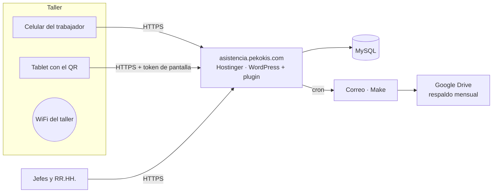
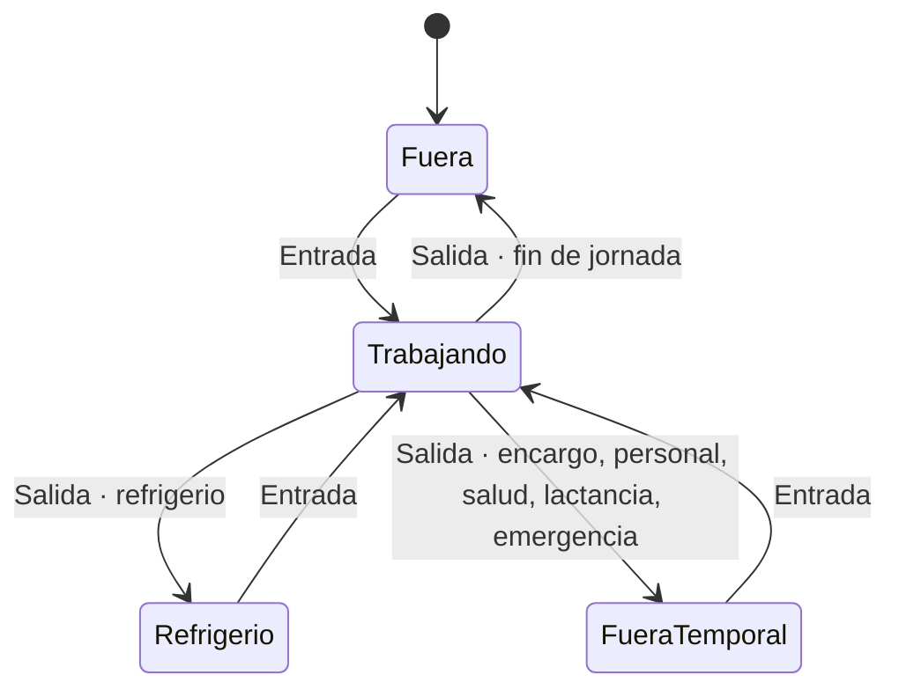

# Sistema de asistencia y RR.HH. de Pekokis — Plan técnico

Borrador para revisión · 13-11-2026

---

## 1. Resumen

Una web para que el personal del taller registre sus entradas y salidas desde su propio celular, sin fotocheck ni lectores. Con esas marcas el sistema calcula horas trabajadas, tardanzas, horas extra, trabajo en sábados, domingos y feriados, y un estimado de pagos que se entrega al contador.

### Decisiones tomadas

| Tema | Decisión |
|---|---|
| Desde dónde se marca | Celular de cada trabajador, en una web que se instala como app (PWA) |
| Quién marca | Passkey del celular (huella, rostro o PIN), pedida **en cada marca** |
| Prueba de que está en el taller | WiFi del taller **o** QR que cambia cada 30 s en una pantalla del taller (el modo se puede cambiar) |
| Hosting | Hostinger, sitio aparte del staging, en `asistencia.pekokis.com` |
| Stack | WordPress mínimo + plugin propio `pekokis-asistencia` (PHP 8.2+, MySQL) |
| Horario base | 9:00 a 19:30 |
| Descartado | Enlaces que se reparten y rotan cada 30 min · GPS como bloqueo · reconocimiento facial · Supabase o Neon |

---

## 2. Alcance

| Módulo (del diagrama) | Qué incluye | Fase |
|---|---|---|
| Registro de perfiles y datos personales | Alta, datos, cargo, área, jefe, horario, cese | 1 |
| Registro de entradas y salidas | Marcas con motivo, WiFi o QR, pantalla QR, "mis marcas" | 1 |
| Seguridad | Passkeys, roles, auditoría, integridad, backups | 1 (transversal) |
| Revisión, ediciones y auditoría | Bandeja de revisión, correcciones con motivo, historial de cambios | 1 |
| Sueldos, valor hora, horas extra, sábados, domingos y feriados | Horarios, calendario, cálculo del día, sobretiempo, sueldos con historial, pre-planilla | 2 |
| Dashboard e informes | Panel del día (fase 1), dashboard general e informe por trabajador (fase 3) | 1 y 3 |
| Notificaciones (opcional) | Correo y luego WhatsApp | 4 |

### Fuera de alcance

- **La planilla oficial**: PLAME, T-Registro, AFP/ONP, EsSalud, renta de 5.ª, gratificaciones, CTS y boletas los sigue haciendo el contador. El sistema le entrega una **pre-planilla** en Excel con horas y montos estimados.
- **Personal que trabaja fuera del taller** (remoto, reparto, ferias). El diseño es para el taller; si aparece ese caso, se resuelve aparte.

---

## 3. Arquitectura



### Infraestructura

- **Sitio nuevo en el plan de Hostinger**, con su propia base de datos. Nada compartido con el staging `pekokis.com.mx`.
- **DNS**: registro de `asistencia.pekokis.com` en Cloudflare en modo **solo DNS (nube gris)**. Así PHP recibe la IP real del celular en `REMOTE_ADDR`. Certificado SSL gratis de Hostinger. Sin el CDN de Hostinger.
- **WordPress mínimo**: tema en blanco propio, sin plugins de caché (quitar el LiteSpeed Cache que instala Hostinger), sin comentarios, sin registro público, sin XML-RPC.
- **Cron real**: cron de hPanel que ejecuta `php wp-cron.php` cada 5 minutos, con `DISABLE_WP_CRON`, igual que en producción. Nunca por URL.
- **Entornos**: local (LocalWP o Docker) con datos de prueba, y producción en Hostinger. Los datos reales nunca salen de producción.
- **Deploy**: repositorio propio en GitHub; en Hostinger, `git pull` + `composer install --no-dev` por SSH o con la herramienta Git de hPanel.
- **Hora**: todo se guarda en UTC y se muestra en hora de Lima (UTC−5). Nunca se usa la hora del celular.

### Partes del plugin

| Parte | Dónde | Cómo |
|---|---|---|
| App del trabajador | `/` | HTML + JS sin framework; `manifest.json`; service worker que solo guarda archivos estáticos, nunca respuestas de la API |
| Pantalla QR | `/pantalla` | Página a pantalla completa; dibuja el QR en el navegador |
| Panel de administración | wp-admin, menú "Asistencia" | Páginas propias del plugin |
| API | `/wp-json/asistencia/v1/…` | REST de WordPress, respuestas con `Cache-Control: no-store` |

**Dependencias** (Composer): `lbuchs/WebAuthn` para las passkeys y `shuchkin/simplexlsxgen` para los Excel. En la pantalla, una librería JS pequeña para dibujar el QR (por ejemplo `qrcode-generator`).

### Estructura del repositorio

La lógica de negocio va en `src/Nucleo/`, en PHP puro sin funciones de WordPress, y se prueba con PHPUnit sin cargar WordPress. `src/WordPress/` es la capa que conecta ese núcleo con la base de datos, la API y el panel. Si algún día el sistema se pasa a Laravel, el núcleo se lleva tal cual.

```
pekokis-asistencia/
├─ pekokis-asistencia.php      # arranque, constantes, autoload
├─ composer.json
├─ phpunit.xml.dist
├─ src/
│  ├─ Nucleo/                  # PHP puro: estados, validación de marcas, presencia (IP y QR),
│  │                           #   pase de presencia, cadena de hashes, día laboral
│  └─ WordPress/               # instalador, roles, ajustes, secretos, endurecimiento;
│                              #   luego API, app del trabajador, pantalla y panel
├─ temas/pka-vacio/            # tema vacío, registrado por el plugin
├─ templates/                  # app del trabajador y pantalla
├─ assets/                     # js, css, íconos, manifest
├─ docs/
└─ tests/Nucleo/
```

---

## 4. Roles y permisos

| Rol | Puede |
|---|---|
| Trabajador | Marcar, ver sus marcas e informes, pedir correcciones y permisos, subir sustentos |
| Jefe de área | Panel del día de su equipo, aprobar o rechazar solicitudes de su equipo, registrar marca manual con motivo |
| RR.HH. / Administrador | Todo lo anterior, más perfiles, sueldos, horarios, calendario, reglas, redes autorizadas, pantallas, reportes y auditoría |
| Gerencia (opcional) | Dashboard e informes en solo lectura |
| Pantalla | Solo pedir el código QR vigente |

- **Sueldos y DNI** solo los ven RR.HH. y el administrador.
- **Los trabajadores no son usuarios de WordPress**: se identifican solo con su passkey. Solo jefes, RR.HH. y administradores entran a wp-admin. Si un jefe también marca asistencia, su perfil de trabajador se enlaza con su usuario (`trabajadores.user_id`).
- Roles de WordPress: `pka_jefe` y `pka_rrhh`. Capacidades: `pka_ver_equipo`, `pka_ver_todo`, `pka_aprobar`, `pka_marca_manual`, `pka_gestionar_personal`, `pka_ver_sueldos`, `pka_ajustes` y `pka_auditoria`. El administrador recibe todas.

---

## 5. Flujos

### 5.1 Alta y activación

1. RR.HH. crea el perfil: datos, cargo, área, jefe, horario y sueldo.
2. El sistema genera un **enlace de activación de un solo uso** que vence en 24 h. Es el único enlace del sistema y solo sirve para activar, no para marcar.
3. El trabajador lo abre en su celular, crea su passkey (huella, rostro o PIN) y agrega la web a su pantalla de inicio.
4. El celular queda vinculado: se guarda un identificador del dispositivo y no se puede activar a otra persona en ese mismo celular.
5. Si cambia de celular, RR.HH. revoca la passkey anterior y genera otro enlace.

Requisito: el celular debe tener bloqueo de pantalla (la passkey exige verificación del usuario).

### 5.2 Marcar

Una sola huella por marca:

1. El trabajador abre la app, o escanea el QR con la cámara del celular (el QR abre la misma web).
2. Pone la huella. El servidor lo identifica con la passkey y responde su estado ("Trabajando desde 08:58"), los botones válidos y un **ticket de marca** que sirve para una sola marca durante 2 minutos.
3. Toca la acción. Si es una salida temporal, elige el motivo.
4. El servidor valida (ver 6.3) y responde, por ejemplo, "Entrada 08:58 ✔ · WiFi".

Si no hay prueba de presencia, la app muestra: "No estás en el WiFi del taller. Escanea el QR de la pantalla o escribe su código".

### 5.3 Pantalla QR

- **El equipo**: tablet Android en la entrada del taller, siempre enchufada, a pantalla completa y sin suspensión.
- **Activación**: un administrador inicia sesión en la tablet y toca "Usar este equipo como pantalla". Se guarda un token largo en una cookie HttpOnly; en la base de datos solo queda su hash. Se puede revocar.
- **Código**: cada 5 s la tablet pide `GET /pantalla/codigo`. El servidor devuelve el token de la ventana actual de 30 s y un código de 6 dígitos.
- **Lo que se ve**: el QR, que lleva a `https://asistencia.pekokis.com/m?q=TOKEN`, el código en números, una cuenta regresiva y la hora oficial.
- **Token**: `HMAC-SHA256(secreto, id_pantalla + número de ventana)`. Se aceptan la ventana actual y la anterior, así que dura como máximo 60 s.
- **Pase de presencia**: al validar el QR o el código, el servidor deja en ese navegador un pase firmado de 3 minutos, para que alcance a elegir el motivo y poner la huella.
- **Límite de intentos**: 5 códigos fallidos bloquean a ese trabajador o dispositivo por 15 minutos.
- **Alertas** (en el panel desde la fase 1 y por correo en la fase 4):
  - pantalla sin pedir código por más de 5 minutos en horario de trabajo (apagada o sin internet);
  - token de pantalla usado desde dos lugares a la vez, o desde una IP distinta a la del taller.
- **La pantalla no se bloquea por IP**: si cambió la IP del taller, el QR es justamente el respaldo.

### 5.4 Solicitudes y correcciones

- **El trabajador puede pedir**:
  - "Olvidé marcar", proponiendo la hora y el motivo;
  - un permiso: salida, día libre o vacaciones;
  - subir un sustento, como un descanso médico en PDF o foto.
- **El jefe** aprueba o rechaza, y queda en la auditoría.
- **Marca manual del jefe**: solo con motivo, y queda registrada como corrección.
- **Nada se edita ni se borra.** Una corrección agrega, anula o reemplaza una marca, y la original sigue visible.

### 5.5 Cierre del día (cron a las 23:00)

- Calcula el día de cada trabajador.
- Si alguien quedó "trabajando" sin salida, el día queda **incompleto** y se avisa al trabajador y al jefe. El sistema nunca completa una marca por su cuenta.
- Si un día laborable no tiene marcas ni permiso, queda como **falta a revisar**.

---

## 6. Reglas de negocio

### 6.1 Estados y marcas

Hay solo dos tipos de marca, **Entrada** y **Salida**, y cada salida lleva un motivo. Toda entrada después de una salida es un regreso.



**Motivos por defecto** (RR.HH. puede cambiarlos):

| Motivo | ¿Cuenta como trabajado? | ¿Necesita aprobación? | ¿Se puede marcar sin estar en el taller? |
|---|---|---|---|
| Refrigerio | No | No | No |
| Encargo de Pekokis | Sí | No | No |
| Personal / trámite | No | Sí, si no pidió permiso antes | No |
| Salud / cita médica | Según política, con sustento | Sí | No |
| Lactancia | Sí | No | No |
| Emergencia | No, salvo decisión de RR.HH. | Se justifica después | **Sí** (queda marcada para revisión) |
| Fin de jornada | — | No | No |

Otras reglas:
- **Pausas cortas** dentro del taller (baño, agua, café) no se marcan.
- **El día termina en la última salida registrada**, tenga el motivo que tenga.
- **Antirrebote**: una segunda marca del mismo tipo en menos de 2 minutos devuelve la primera, sin duplicar.
- **Día laboral**: se cuenta en hora de Lima con corte a las 04:00; lo marcado antes de esa hora pertenece al día anterior. Si alguien olvidó marcar la salida ayer, hoy empieza como "Fuera" y el día anterior queda incompleto.

### 6.2 Presencia

Hay un ajuste con el modo de presencia: `wifi_o_qr` (el inicial), `wifi_y_qr`, `solo_qr` y `solo_wifi`.

- **WiFi**: la IP de la petición (`REMOTE_ADDR`) debe estar en las redes autorizadas. En IPv4 se compara la IP exacta; en IPv6, el prefijo (/56 o /64).
- **Antes de activar el WiFi**: revisar la IP de internet (WAN) en el router del taller. Si está entre `100.64.0.0` y `100.127.255.255`, el proveedor usa una IP compartida (CGNAT) y hay que usar `solo_qr` o pedir una IP fija.
- **IP nueva**: si 3 o más marcas con QR válido llegan en un día desde la misma IP desconocida, el sistema avisa al administrador con un botón "Es la nueva IP del taller". Nunca la agrega solo.
- **La presencia se vuelve a comprobar al guardar la marca**, no solo al abrir la app.
- Cada marca guarda la **prueba** que usó: `wifi`, `qr`, `wifi+qr`, `sin_presencia` (emergencia) o `manual`.

### 6.3 Validación de una marca en el servidor

En este orden:

1. El ticket de marca existe, está vigente (2 minutos) y no se usó.
2. La passkey no está revocada y el trabajador está activo.
3. La presencia cumple el modo configurado, salvo que el motivo permita marcar sin estar en el taller.
4. La acción es válida para el estado actual.
5. Antirrebote.
6. Se guarda con la hora del servidor (UTC), la IP, el dispositivo, la credencial, la prueba de presencia y el hash encadenado.
7. Se recalcula el día.

Los intentos fallidos se registran y cuentan para el límite de intentos.

### 6.4 Horarios y calendario

- **Horario base de Pekokis**: 9:00 a 19:30, de lunes a viernes (por confirmar). La duración y franja del refrigerio están por definir.
- Cada trabajador tiene un horario asignado, que puede ser distinto al base.
- **Tolerancia** configurable, por ejemplo 5 minutos.
- **Calendario**: RR.HH. carga cada año los feriados nacionales y los días no laborables de la empresa.
- **Sábados, domingos y feriados**: el trabajo en esos días se programa antes, indicando quién, qué día, qué horas y cómo se compensa (pago con sobretasa o descanso sustitutorio). Si alguien marca en esos días sin programación, la marca se guarda igual y queda "a revisar".

> **Ojo con la jornada máxima.** 9:00 a 19:30 menos 1 h de refrigerio son 9,5 h al día. De lunes a viernes suman 47,5 h por semana, dentro del máximo legal de 48. Cualquier sábado trabajado pasa a ser sobretiempo. Hay que confirmarlo con el contador.

### 6.5 Cálculo del día

A partir de las marcas efectivas (descontando correcciones), los permisos y el horario del día:

1. Arma los tramos *dentro* (de una entrada a una salida) y *fuera* (de una salida a la siguiente entrada).
2. **Tiempo trabajado** = los tramos dentro, más los tramos fuera cuyo motivo cuenta como trabajado y está aprobado.
3. **Tardanza** = primera entrada después de la hora de inicio más la tolerancia.
4. **Exceso de refrigerio** = refrigerio real menos el refrigerio del horario, si es positivo.
5. **Salida anticipada** = última salida antes de la hora de fin, salvo que haya permiso o emergencia aprobada.
6. **Tiempo fuera de horario**: se separa en *sobretiempo autorizado* y *permanencia sin autorizar*.
7. **Sobretiempo autorizado**: las 2 primeras horas del día van al 25 % y el resto al 35 %.
8. **Trabajo en descanso semanal o feriado**: va a su propia bolsa (sobretasa del 100 % o descanso sustitutorio).
9. **Estado del día**: completo, incompleto, falta, justificado o a revisar.

El resultado se guarda en `pka_dias` como caché. La fuente de verdad son siempre las marcas, las correcciones, los permisos y los horarios.

**Reglas legales por defecto** (configurables; hay que validarlas con el contador antes de la fase 2):

- **Sobretiempo**: sobretasa mínima del 25 % las dos primeras horas y del 35 % las siguientes (TUO de jornada, D.S. 007-2002-TR).
- **Feriado o día de descanso trabajado** sin descanso sustitutorio: sobretasa del 100 % (D.Leg. 713).
- **Refrigerio**: mínimo 45 minutos y no forma parte de la jornada.
- **Lactancia**: 1 hora diaria hasta que el bebé cumple un año, y cuenta como tiempo trabajado (Ley 27240).
- **Permanencia fuera de horario**: la normativa de jornada presume sobretiempo por el tiempo que el trabajador se queda en el centro de trabajo fuera de su horario, salvo prueba en contrario. Por eso el sistema separa el sobretiempo autorizado de la permanencia sin autorizar y se lo muestra al jefe el mismo día.
- **Tardanzas**: se descuenta el tiempo no trabajado. No se aplican multas.

### 6.6 Pagos (recibos por honorarios)

Decidido el 14-11-2026, siguiendo las maquetas entregadas por Pekokis (`CONTEXTO_SISTEMA_ASISTENCIA.md`, sección 8). Reemplaza el cálculo de la 0.7.0, que era al estilo planilla: sobretasas del 25 % y 35 %, valor hora y sobretiempo autorizado.

- Cada persona tiene un **honorario mensual** y **4 tarifas por hora**: extra, sábado, domingo y feriado. Cada cambio se guarda con su fecha de vigencia.
- **Total del mes** = honorario + horas extra × tarifa extra + horas de sábado × tarifa sábado + horas de domingo × tarifa domingo + horas de feriado × tarifa feriado.
- **Horas extra de lunes a viernes:** lo trabajado por encima de la jornada efectiva del horario (9 h 30 min con el horario base). Son automáticas: no se autorizan.
- **Sábado, domingo y feriado:** todas las horas van con su tarifa. Un día de semana libre en el horario de la persona: todo es hora extra.
- **Comida no marcada:** en días laborables se descuentan 60 min (configurable; por confirmar).
- **No hay descuentos:** las faltas, tardanzas y salidas anticipadas se señalan, pero no se descuentan (por confirmar).
- **Estado del pago:** "Listo para pagar", "Resolver incidencia" (días incompletos o marcas por revisar) o "Falta su honorario". El recibo por honorarios no frena el pago.
- **Planilla de pagos** en Excel (Exportar y Pagos), con una fila por persona, el detalle por día y las reglas.
- **Calculadora** (Asistencia → Pagos, versión 0.11.0): total del mes; "Antes de pagar" (incidencias, personas sin honorario, estado de los recibos); una fila por persona con "Ver cálculo" y la casilla "Pagado" (guarda el total de ese momento; desmarcar no borra, anula); planilla de las listas o de todas.

### 6.7 Recibos por honorarios (versión 0.11.0)

- Un recibo por persona y mes, con número (serie-número, por ejemplo E001-482), monto y PDF (no vacío, hasta 5 MB). El trabajador lo envía desde la app ("Mi recibo"), con un permiso de 15 minutos que da su huella.
- Estados: falta enviar → enviado (se puede anular mientras no se revise) → recibido u observado (con comentario; se corrige enviando otro). En la app, "Pagado" cuando el mes ya se marcó como pagado.
- Gerencia (Asistencia → Recibos): pestañas por mes, filtros, comparación con el cálculo ("Coincide" / "Difiere S/ x"), recibido u observar, "Recordar" a quien falta (sale aunque los avisos estén apagados) y el historial de cada persona.
- Los PDF van a `uploads/pka-recibos/`, con nombre aleatorio y un `.htaccess` que niega el acceso directo. Solo se abren desde wp-admin con permiso para ver sueldos, y cada apertura queda en el historial.

### 6.8 App del trabajador (versión 0.12.0, diseño de las maquetas)

- **Sesión:** al poner la huella se crea la cookie `pka_sesion` (HttpOnly, 30 días; los datos quedan en el servidor). Sirve para ver Marcar, Mis horas, Mi recibo y Perfil. **No sirve para marcar:** cada marca pide la huella otra vez (el ticket de 2 minutos). La sesión deja de valer si se revoca la llave o la persona cesa, y se cierra desde Perfil.
- **Marcar (T2):** botón único según `VistaDia` (entrada → salir a comer → volver de comer → salida); las salidas temporales van como botón secundario con su motivo. Tarjeta grande: lo que lleva trabajando y lo que falta; en comida o fuera, desde cuándo. Sin presencia, los botones se apagan y aparece cómo conseguirla (WiFi o QR). El botón Escanear usa `BarcodeDetector` donde exista (Android) y, si no, el código de 6 números.
- **Mis horas (T5/T6):** horas, extra y días completos (sin dinero), "Te falta marcar", calendario con cada día tocable y el detalle con sus pasos, otras salidas y correcciones pedidas. "Pedir corrección" manda la hora, qué pasó y un comentario a `POST /correcciones`.
- **Perfil (T7):** DNI oculto; "Ver" lo trae con `POST /yo/dni` y queda en el historial.

---

## 7. Modelo de datos

Todas las tablas usan el prefijo `{$wpdb->prefix}pka_`.

| Tabla | Campos principales |
|---|---|
| `trabajadores` | id, user_id, dni, nombres, apellidos, telefono, correo, cargo, area, jefe_id, horario_id, fecha_ingreso, fecha_cese, estado |
| `sueldos` | id, trabajador_id, modalidad (mensual/por_hora), monto, vigente_desde, vigente_hasta, creado_por |
| `horarios` | id, nombre, tolerancia_min, refrigerio_min |
| `horario_dias` | horario_id, dia_semana, entrada, salida, laborable |
| `calendario` | fecha, tipo (feriado/no_laborable), nombre |
| `motivos` | id, clave, nombre, cuenta_como_trabajado, requiere_aprobacion, sin_presencia, activo |
| `marcas` | id, trabajador_id, dia_laboral, tipo, motivo_clave, nota, marcado_utc, prueba, requiere_revision, ip, dispositivo_id, credencial_id, pantalla_id, origen, correccion_id, registrado_por, hash_anterior, hash |
| `revisiones` | id, marca_id, decision (aprobada/rechazada), nota, revisado_por, revisado_en |
| `correcciones` | id, trabajador_id, accion (agregar/anular/reemplazar), marca_id, datos, motivo, solicitado_por, resuelto_por, estado, fechas |
| `permisos` | id, trabajador_id, tipo, desde, hasta, motivo, sustento_id, estado, resuelto_por |
| `sobretiempo` | id, trabajador_id, fecha, desde, hasta, compensacion (pago/descanso), autorizado_por |
| `dias` | trabajador_id, fecha, estado, min_trabajados, min_tardanza, min_exceso_refrigerio, min_salida_anticipada, min_extra_25, min_extra_35, min_descanso_feriado, min_sin_autorizar, recalculado_en |
| `credenciales` | id, trabajador_id, credential_id, public_key, sign_count, dispositivo_id, nombre, creado, ultimo_uso, revocada_en |
| `dispositivos` | id, trabajador_id, token_hash, user_agent, creado, ultimo_uso, revocado_en |
| `activaciones` | token_hash, trabajador_id, expira, usado_en |
| `redes` | id, ip_o_prefijo, nombre, activa, creada_por |
| `pantallas` | id, nombre, token_hash, ultima_conexion, ultima_ip, activa |
| `auditoria` | id, actor_id, accion, entidad, entidad_id, antes, despues, motivo, ip, fecha, hash_anterior, hash |
| `notificaciones` | id, destinatario, canal, evento, datos, estado, enviado_en (fase 4) |

Los ajustes generales (modo de presencia, tolerancias, secreto del QR) van en `wp_options`, salvo los secretos, que van en `wp-config.php`.

### Integridad

- `marcas` y `auditoria` **solo admiten inserciones**: el código nunca hace UPDATE ni DELETE sobre ellas.
- Cada fila guarda `hash = SHA-256(hash_anterior + datos de la fila)`, lo que forma una cadena verificable: si alguien altera una fila directamente en la base de datos, la cadena se rompe.
- Si Hostinger permite triggers en MySQL, se bloquean también UPDATE y DELETE a nivel de base de datos.
- El export mensual incluye el último hash del mes.

---

## 8. API

Todas las rutas van bajo `/wp-json/asistencia/v1`.

| Método y ruta | Quién | Para qué |
|---|---|---|
| `POST /activacion/opciones` | Trabajador con enlace | Reto para crear la passkey |
| `POST /activacion/completar` | Trabajador con enlace | Guarda la passkey y vincula el celular |
| `POST /identificar/opciones` | Público | Reto para la huella |
| `POST /identificar` | Público | Verifica la huella; devuelve estado, botones válidos y el ticket de marca |
| `GET /presencia` | Público | Indica si la petición viene del WiFi del taller o tiene un pase de presencia vigente |
| `POST /presencia/codigo` | Público | Valida el QR o el código de 6 dígitos y deja el pase de presencia |
| `POST /marcas` | Trabajador (con ticket) | Crea la marca |
| `GET /yo` | Trabajador (sesión) | Estado del día, "Tu día", presencia y si falta aceptar el aviso |
| `POST /yo/mes` | Trabajador (sesión o ticket) | Calendario, detalle de cada día y resumen del mes |
| `GET /yo/perfil` · `POST /yo/dni` | Trabajador (sesión) | Perfil con el DNI oculto; mostrarlo completo queda en el historial |
| `POST /yo/salir` | Trabajador | Cierra la sesión de ese celular |
| `POST /yo/recibos` (y `/enviar`, `/anular`) | Trabajador (sesión) | Sus recibos por honorarios |
| `POST /correcciones` | Trabajador (sesión o ticket) | "Olvidé marcar": queda pendiente para su jefe |
| `GET /pantalla/codigo` | Pantalla | Token y código vigentes |
| `…/admin/*` | Jefe, RR.HH. | Panel del día, aprobaciones, marcas manuales, reportes |

La página `/m?q=TOKEN`, que es la que abre el QR, llama sola a `POST /presencia/codigo` y sigue con el flujo de marcar.

---

## 9. Seguridad

- **Trabajadores sin contraseña**: entran solo con passkey, con verificación del usuario obligatoria. Los retos son de un solo uso y vencen en 2 minutos.
- **Administradores y jefes**: contraseña fuerte más passkey o segundo factor obligatorio, sesiones de 8 horas y cierre por inactividad.
- **Roles y capacidades**: sueldos y DNI solo para RR.HH. y el administrador.
- **HTTPS obligatorio**; cookies `Secure`, `HttpOnly` y `SameSite`.
- **Nonces de WordPress** en todo el panel.
- **Límite de intentos** en huella, códigos QR e inicio de sesión de administradores.
- **Un celular por trabajador**; las passkeys, los dispositivos y las pantallas se pueden revocar.
- **Marcas y auditoría** solo admiten inserciones, con la cadena de hashes.
- **Secretos** (HMAC del QR y claves) en `wp-config.php`, fuera del repositorio.
- **Sin caché**: ni LiteSpeed, ni CDN; el service worker solo guarda archivos estáticos y la API responde con `no-store`.
- **WordPress mínimo**: sin plugins de terceros salvo SMTP, con actualizaciones de seguridad al día, XML-RPC apagado y el listado de usuarios por REST apagado.
- **Backups**:
  - diarios de Hostinger;
  - un export mensual del registro (Excel + hash) que va por correo a RR.HH. y a Google Drive mediante Make;
  - un dump semanal cifrado de la base de datos.
- **Opcional**: cifrar el monto del sueldo en la base de datos con libsodium.

---

## 10. Cumplimiento legal y datos personales

Esto es lo que entendemos de la norma; hay que confirmarlo con el contador o el abogado laboral.

- **Registro de asistencia (D.S. 004-2006-TR)**:
  - el trabajador marca personalmente;
  - contenido mínimo: razón social y RUC, nombre y DNI del trabajador, fecha y hora y minuto de ingreso y de salida, y sobretiempo;
  - puede ser digital, con medidas contra la adulteración;
  - se conserva 5 años y debe estar a disposición de SUNAFIL y del trabajador.
- **Datos personales (Ley 29733 y su reglamento, D.S. 016-2024-JUS)**:
  - aviso escrito a cada trabajador sobre qué se guarda (hora, IP, dispositivo, motivo), para qué, quién accede y por cuánto tiempo;
  - **no se guardan** huellas (se quedan en el celular), fotos ni ubicación;
  - acceso restringido por rol;
  - consultar con el abogado si hay que inscribir el banco de datos de trabajadores ante la Autoridad Nacional de Protección de Datos Personales.
- **Retención**: el registro se guarda 5 años. Qué hacer con los perfiles de quienes dejan la empresa se define con el contador o el abogado.

---

## 11. Dashboard e informes

- **Panel del día** (fase 1), que se actualiza cada 30 s:
  - presentes, tarde y ausentes;
  - en refrigerio, con los minutos que lleva;
  - fuera, con el motivo;
  - marcas a revisar y solicitudes pendientes;
  - estado de la pantalla QR y avisos de IP nueva.
- **Dashboard general** (fase 3), por mes:
  - horas trabajadas, horas extra (en horas y soles estimados), tardanzas, faltas y feriados trabajados, por trabajador y en total;
  - comparación con meses anteriores;
  - costo estimado de las horas extra.
- **Informe por trabajador**: calendario del mes con colores por estado, el detalle de cada día (marcas, prueba usada, correcciones) y totales. Se exporta en Excel; el PDF es opcional.
- **Vista del trabajador**: su propio informe, sin datos de los demás.
- **Exports**:
  - registro de asistencia mensual, en el formato para SUNAFIL;
  - pre-planilla para el contador.

---

## 12. Notificaciones (opcional, fase 4)

| Evento | A quién |
|---|---|
| A las 20:00 sigue figurando como "trabajando" | Trabajador |
| Refrigerio o salida temporal que pasa del límite | Jefe |
| Solicitud nueva | Jefe |
| Solicitud aprobada o rechazada | Trabajador |
| Ausentes a las 9:15 | Jefe |
| Pantalla QR sin conexión | Administrador |
| IP nueva detectada | Administrador |
| Export mensual listo | RR.HH. |

Canales:
- **Correo** desde el principio, por SMTP del dominio.
- **WhatsApp** después, mediante Make o el número de la API de Meta del bot.
- **Push web** solo si hace falta; en iPhone solo funciona con la app instalada.

---

## 13. Fases y estimación

La estimación es gruesa y sirve solo como orden de magnitud.

| Fase | Entrega | Horas |
|---|---|---|
| 0. Preparación | Decisiones pendientes (sección 16), IP del router, sitio en Hostinger, subdominio, repositorio, tablet | 4–8 |
| 1. Registro (cumple la norma) | Perfiles básicos, activación con passkey, marcas con motivos, WiFi o QR, pantalla, "mis marcas", panel del día, correcciones y auditoría, export mensual, backups | 50–70 |
| 2. Horas y sueldos | Horarios, calendario y feriados, cálculo del día, sobretiempo autorizado, sábados, domingos y feriados, sueldos con historial, valor hora, permisos y sustentos, pre-planilla | 40–60 |
| 3. Dashboard e informes | Dashboard general, informe por trabajador, Excel y PDF | 20–30 |
| 4. Notificaciones | Correo, luego WhatsApp | 10–20 |
| Piloto | Dos semanas en paralelo con el método actual | 10–15 |
| **Total** | | **≈ 135–200** |

Con la fase 1 ya se cumple el registro de asistencia que pide la norma. La fase 2 es la que depende de las reglas que valide el contador.

**14-11-2026:** la fase 2 empezó con la versión 0.7.0 (cálculo del día, horas extra autorizadas, sueldos con historial y pre-planilla). Las reglas de la sección 6.5 quedaron configurables en Ajustes, a la espera del contador. Todavía no se guardan los días en `pka_dias`: se calculan al vuelo.

**14-11-2026:** la fase 3 llegó con la versión 0.8.0: Resumen del mes (dashboard con comparación de 6 meses) e Informe por trabajador (calendario, detalle, Excel y vista para imprimir o guardar como PDF). El PDF sale del navegador, sin librerías en el servidor.

**14-11-2026:** la fase 4 (avisos) llegó con la versión 0.9.0. Tiene una cola en la tabla `avisos` y un cron cada 5 minutos, y agrupa por destinatario. Avisa por correo y por un webhook firmado para WhatsApp. Todo empieza apagado. El envío por WhatsApp (escenario de Make o bot con la API de Meta) queda para cuando se apruebe la plantilla del mensaje en Meta.

**Decisión del 13-11-2026:** el MVP son las fases 0 y 1. Las fases 2, 3 y 4 se harán por etapas, según lo que pida gerencia. El avance se lleva en [TAREAS.md](../TAREAS.md).

---

## 14. Pruebas y piloto

- **Pruebas automáticas (PHPUnit) del motor de cálculo**, con al menos estos casos:
  - día normal;
  - tardanza dentro y fuera de la tolerancia;
  - refrigerio largo;
  - salida por encargo y salida personal;
  - emergencia sin regreso;
  - olvido de salida;
  - sábado sin programar;
  - domingo con descanso sustitutorio;
  - feriado pagado;
  - más de 2 horas de sobretiempo;
  - cambio de sueldo a mitad de mes;
  - día que pasa la medianoche.
- **Pruebas de validación de marcas**:
  - sin presencia;
  - ticket vencido o reutilizado;
  - QR de una ventana vieja;
  - doble marca;
  - estado inválido;
  - passkey revocada;
  - límite de intentos.
- **Celulares reales**: Android con Chrome e iPhone con Safari, con la app instalada y desde el navegador.
- **Piloto**: una semana con 3 o 4 trabajadores y una semana con todos, en paralelo con el método actual, comparando los resultados.

---

## 15. Riesgos

| Riesgo | Mitigación |
|---|---|
| Un trabajador presta su celular desbloqueado | Un celular por trabajador, panel del jefe en vivo; opcional: foto al marcar, sin reconocimiento facial |
| QR reenviado por WhatsApp en menos de 60 s (complicidad) | Validez corta; si ocurre, pasar al modo `wifi_y_qr` |
| La señal del WiFi llega fuera del taller | Modo `wifi_y_qr` o `solo_qr` |
| La IP del taller cambia o es compartida (CGNAT) | QR como respaldo, aviso de IP nueva, pedir IP fija |
| Pantalla apagada y sin WiFi a la vez | Marca manual del jefe con motivo |
| Trabajador sin smartphone o sin bloqueo de pantalla | Pendiente de decidir: modo kiosko en la tablet con PIN, o marca asistida |
| Error en el cálculo de pagos | Pruebas automáticas, validación del contador, montos marcados como estimados |
| Pérdida de datos | Backups de Hostinger, export mensual fuera del hosting, dump semanal |

---

## 16. Pendiente de decidir (con gerencia y el contador)

1. **Jornada**: ¿9:00 a 19:30 de lunes a viernes? ¿Se trabaja los sábados? ¿Cuánto dura el refrigerio y en qué franja?
2. **Tardanzas**: ¿cuánta tolerancia? ¿La tardanza se cuenta desde las 9:00 o desde el fin de la tolerancia? ¿Qué política de descuento se aplica?
3. **Salidas**: ¿cuáles cuentan como tiempo trabajado (encargo, salud, emergencia)?
4. **Pago**: ¿cuál es la fórmula del valor hora? ¿Quién cobra por hora?
5. **Horas extra**: ¿quién las autoriza y con cuánta anticipación? ¿Se pagan o se compensan con descanso?
6. **Jefes**: ¿quién aprueba las solicitudes de quién?
7. **Celulares**: ¿todos tienen smartphone con bloqueo de pantalla? Si no, ¿modo kiosko con PIN en la tablet o marca asistida?
8. **IP del taller**: revisar el router por si hay CGNAT y ver si se puede pedir IP fija.
9. **Tablet**: ¿se compra o hay una disponible? ¿Dónde va el soporte en la entrada?
10. **Aviso de datos personales**: redactarlo con el abogado.
11. **Método actual de asistencia** y fecha de inicio del piloto.
